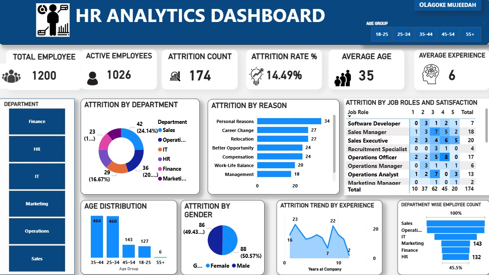

# HR-Analytics-PowerBI-Dashboard
Interactive Power BI dashboard analyzing employee headcount, demographics, and attrition drivers.
# 📊 HR Analytics Dashboard (Power BI)

An interactive Power BI dashboard that analyses employee attrition, demographics and workforce structure for a 1,200-employee Nigerian company, helping HR identify **who is leaving, from where, and why**.


---

## 📌 Table of Contents
- [Project Overview](#-project-overview)
- [Business Problem](#-business-problem)
- [Dataset](#-dataset)
- [Tools & Skills](#-tools--skills)
- [Data Preparation](#-data-preparation)
- [Dashboard Features](#-dashboard-features)
- [Key Insights](#-key-insights)
- [Recommendations](#-recommendations)
- [How to Use](#-how-to-use)

---

## 🔎 Project Overview
Employee turnover is expensive: lost knowledge, recruitment costs and lower morale. This project turns raw HR records into a one-page dashboard that lets HR managers:

- Track headcount, attrition count and attrition rate at a glance
- Compare attrition across departments, job roles, gender, age group and tenure
- Understand the reasons employees give for leaving
- Filter everything by **Department** and **Age Group**

## 🎯 Business Problem
The company lost **174 of 1,200 employees (14.5%)**. Leadership wants to know:

1. Which departments and job roles are losing the most people?
2. What are the main reasons for leaving?
3. Does attrition depend on age, gender, tenure, overtime or job satisfaction?
4. What can HR do to improve retention?

## 🗂 Dataset
- **Source:** Simulated HR dataset (Nigerian context, salaries in NGN)
- **Size:** 1,200 rows × 25 columns (`data/HR_POWERBI_DATASET.xlsx`)

| Category | Columns |
|---|---|
| Employee info | Employee ID, Employee Name, Gender, Age, Age Group, Education |
| Job info | Department, Job Role, Location, Employment Type, Hire Date, Hire Year, Years at Company |
| Compensation & performance | Annual Salary (NGN), Performance Rating, Job Satisfaction, Overtime, Training Hours |
| Time off | Leave Days, Absence Days |
| Career growth | Promotion, Promotion Count |
| Attrition | Attrition, Attrition Flag (1/0), Reason for Leaving |

## 🛠 Tools & Skills
- **Power BI Desktop**: data modelling, DAX measures, interactive visuals, slicers
- **Power Query**: data cleaning and transformation
- **Excel**: source data
- **DAX**: calculated measures and columns

## 🧹 Data Preparation
1. Imported the Excel file into Power BI and checked data types
2. Cleaned and standardised text columns (department, job role, location)
3. Created **Age Group** bands: 18–25, 25–34, 35–44, 45–54, 55+
4. Created **Attrition Flag** (1 = left, 0 = active) for easy aggregation
5. Calculated **Years at Company** from the hire date
6. Built the DAX measures below

### Key Measures
| Measure | Purpose |
|---|---|
| `EMPLOYEE COUNT` | Total headcount |
| `ATTRITIONCOUNT` | Number of employees who left |
| `ATTRITION RATE%` | Attrition count ÷ total employees |
| `AVERAGE SALARY` | Mean annual salary (NGN) |
| Active Employees | Total employees − attrition count |
| Average Age / Average Experience | Mean of Age / Years at Company |

## 📈 Dashboard Features
**KPI cards:** Total Employees · Active Employees · Attrition Count · Attrition Rate % · Average Age · Average Experience

**Visuals**
- Attrition by Department (donut)
- Attrition by Reason (bar)
- Attrition by Job Role × Job Satisfaction (matrix heat-map)
- Age Distribution (column chart)
- Attrition by Gender (pie)
- Attrition Trend by Experience (area chart)
- Department-wise Employee Count (funnel)

**Interactivity:** Department buttons and Age Group slicers filter the whole page.

## 💡 Key Insights
| Metric | Value |
|---|---|
| Total employees | 1,200 |
| Active employees | 1,026 |
| Employees who left | 174 |
| Attrition rate | ~14.5% |
| Average age | 35 |
| Average tenure | 6 years |

- **Sales loses the most people** (42, about 24% of all leavers), followed by Operations (36) and IT (29). Sales and Operations are also the two largest departments.
- **HR has the highest attrition rate relative to its size (~18.9%)**, followed by Finance (~16.7%).
- **Personal reasons (34) are the top reason for leaving**. Career Change and Relocation follow with 27 each, while **Compensation + Better Opportunity account for 48 exits (~28%)**, which are controllable factors.
- **Employees who work overtime leave more often**: ~19.4% attrition versus ~12.2% for those who do not.
- **Attrition is almost evenly split by gender** (Female 88, Male 86).
- The workforce is young: **ages 25–44 make up about 77% of employees** (35–44: 464, 25–34: 460).
- Most leavers rate job satisfaction **3 or lower** (109 of 174, about 63%), so low satisfaction is a warning sign.

## ✅ Recommendations
1. **Review workloads and overtime**, especially in Sales and Operations, since overtime is linked to higher attrition.
2. **Investigate the HR and Finance departments**, which have the highest attrition rates.
3. **Revisit compensation and career-growth paths** to reduce exits to better opportunities.
4. **Run regular satisfaction surveys** and act early on scores of 3 or lower.
5. **Strengthen onboarding and mentoring** for employees in their first few years.
6. **Collect exit-interview data** to dig into "Personal Reasons", the largest category.

## 🚀 How to Use
1. Clone or download this repository
   ```bash
   git clone https://github.com/<your-username>/hr-analytics-powerbi.git
   ```
2. Install [Power BI Desktop](https://powerbi.microsoft.com/desktop/) (free, Windows)
3. Open `powerbi/HR_POWER_BI.pbix`
4. If prompted, point the data source to `data/HR_POWERBI_DATASET.xlsx` (Home → Transform data → Data source settings)
5. Use the department buttons and age group slicers to explore

⭐ If you found this project useful, please give it a star!
